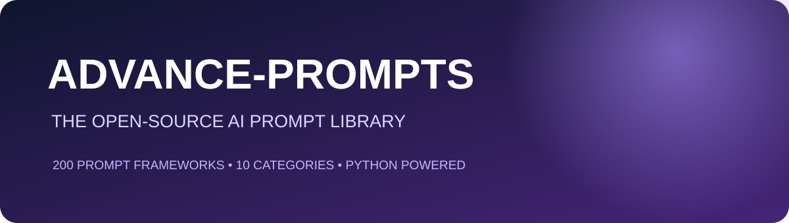

<div align="center">


# ADVANCE-PROMPTS
### An Open-Source Python Library for AI Prompt Engineering
**200 original prompt frameworks across 10 practical categories.**

[Browse prompts](prompts/all_prompts.json) · [Python API](#python-library) · [Contributing](CONTRIBUTING.md)

   

[](https://github.com/Aanisadk/advance-prompts/stargazers) [](https://github.com/Aanisadk/advance-prompts/network/members) [](https://github.com/Aanisadk/advance-prompts/issues)
</div>

---

## About
ADVANCE-PROMPTS is a community-oriented collection of reusable prompt frameworks for students, developers, creators, researchers, and professionals. Each entry includes a stable ID, category, intended platform, difficulty, description, prompt text, variables, and usage guidance. The Python package lets you browse and search the collection locally; it does not call an AI API and needs no API key.

> Independent community project. Not affiliated with or endorsed by OpenAI, Anthropic, Google, or other AI providers. Model behaviour changes; verify model-specific advice against official documentation.

## Collection

| Category | Prompts |
|---|---:|
| ChatGPT & General AI | 20 |
| Claude Workflows | 20 |
| Gemini & Multimodal | 20 |
| Image Generation | 20 |
| Video Generation | 20 |
| Python & Coding | 20 |
| Productivity | 20 |
| Writing | 20 |
| Marketing | 20 |
| Research & Learning | 20 |
| **Total** | **200** |

Browse the folders in [`prompts/`](prompts/) or open the [complete catalogue](prompts/all_prompts.json).

## Quick start

Browse `prompts/`, choose a category, open its `prompts.json`, replace the `{variables}`, then paste the prompt into your preferred AI tool.

### Install locally
```bash
git clone https://github.com/Aanisadk/advance-prompts.git
cd advance-prompts
python -m pip install -e .
```

### Python library
```python
from advance_prompts import get_prompt, search_prompts, list_categories

print(list_categories())
prompt = get_prompt("claude-001")
print(prompt["prompt"])
for result in search_prompts("project"):
    print(result["id"], result["title"])
```

| Function | Purpose |
|---|---|
| `all_prompts()` | Return all records |
| `get_prompt(prompt_id)` | Retrieve a prompt by ID |
| `search_prompts(query, category=None)` | Search the catalogue |
| `list_categories()` | List categories |

## Claude-focused workflows
The Claude collection includes XML-structured instructions, long-context synthesis, few-shot examples, codebase onboarding, `CLAUDE.md` drafting, agentic task planning, tool-use boundaries, context handoffs, and evidence-led research. These are original templates informed by public prompting principles—not copied provider prompts. See [Anthropic's official prompting guidance](https://docs.anthropic.com/en/docs/build-with-claude/prompt-engineering/overview) and check it for model-specific updates.

## What makes a useful prompt?
- **Task:** what should be done.
- **Context:** what the model needs to know.
- **Constraints:** boundaries and requirements.
- **Output:** format, audience, and level of detail.
- **Verification:** how uncertainty and unsupported claims are handled.

## Contributing
Contributions are welcome. Read [CONTRIBUTING.md](CONTRIBUTING.md), submit original or appropriately licensed prompts, explain every variable, and avoid confidential, harmful, or misleading content.

## Roadmap
- [x] 200 prompt frameworks across 10 categories
- [x] Python package and local search
- [x] JSON catalogue, tests, and GitHub Actions
- [ ] Community submissions and prompt evaluations
- [ ] Searchable web catalogue

## License
MIT License. See [LICENSE](LICENSE).

<div align="center">If this library helps you, consider giving it a ⭐ and contributing a prompt.
</div>
